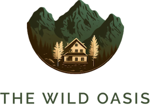
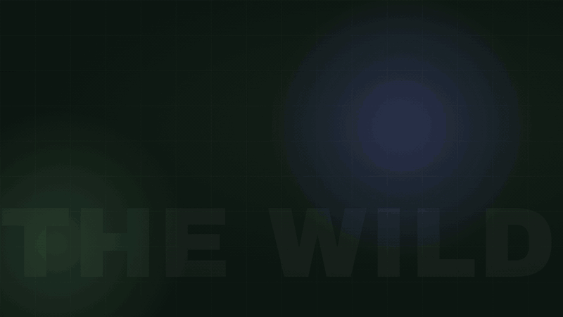
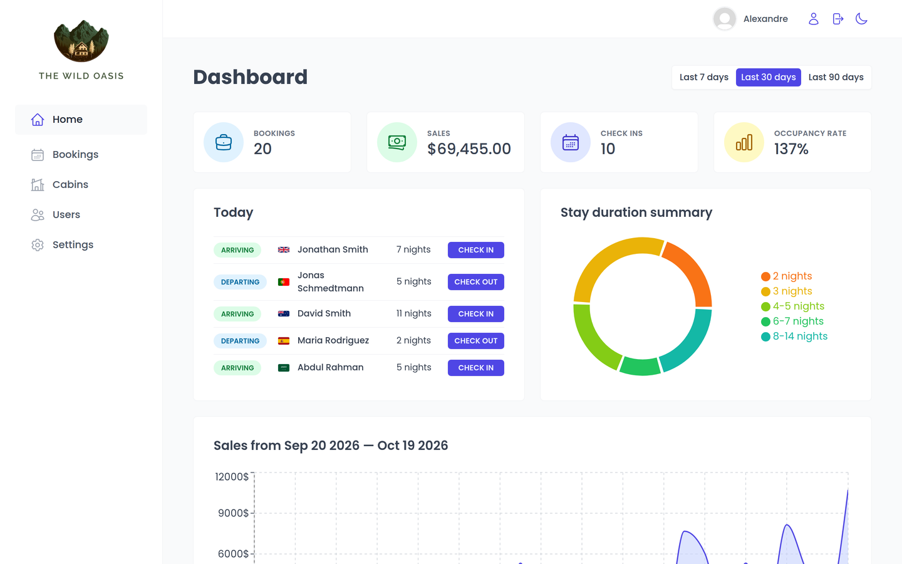
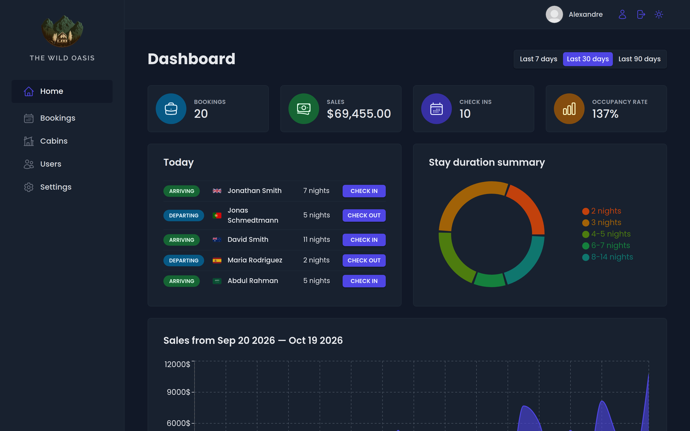
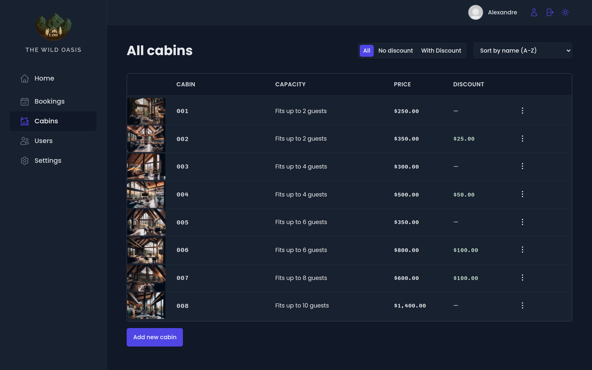
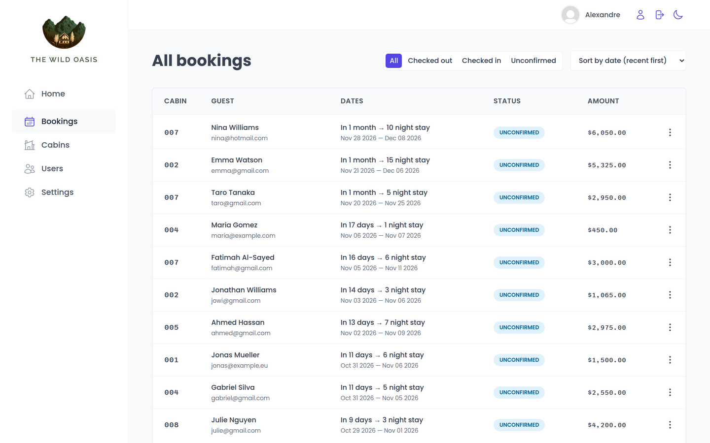
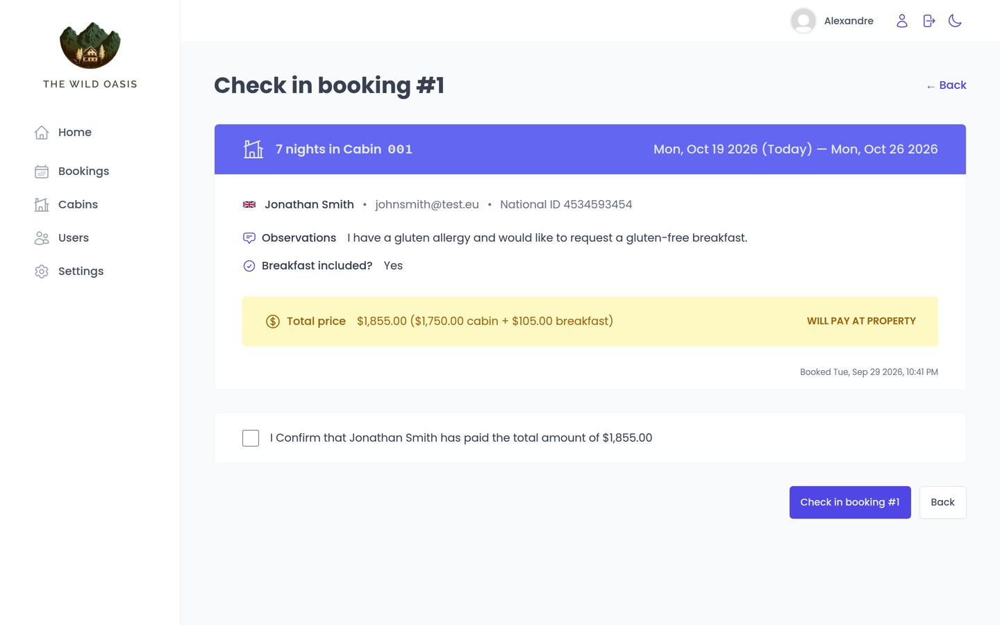
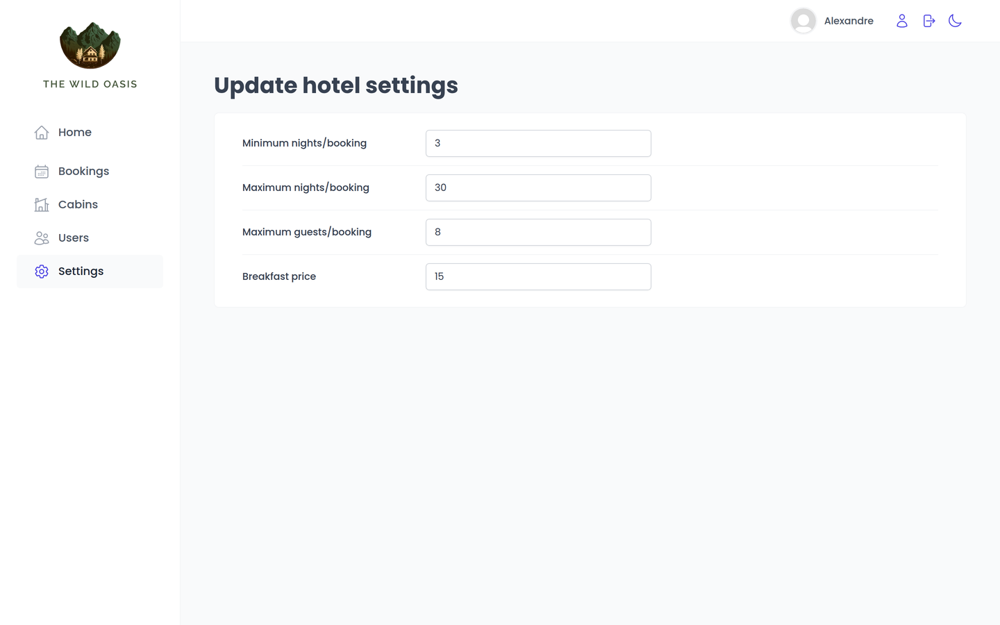

<div align="center">



# The Wild Oasis

**An internal hotel-management app for a small chain of luxury forest cabins.**
Staff use it to manage cabins, track bookings, check guests in and out, and see how the business is doing.


<a href="docs/media/oasis-promo.mp4">
  
</a>

<sub>15-second tour · <a href="docs/media/oasis-promo.mp4">watch in full quality (MP4)</a></sub>

</div>

---

## About

The Wild Oasis is a project I built while studying React, based on the Wild Oasis app from Jonas Schmedtmann's _Ultimate React Course_.
It covers most of what a real-world React app needs: server state with React Query, a real backend (Supabase auth, database and storage), forms, compound components, protected routes, and a theme system.

## Features

| Area | What you can do |
| --- | --- |
| 📊 **Dashboard** | Bookings, sales, check-ins and occupancy for the last 7 / 30 / 90 days. Today's arrivals and departures, a stay-duration donut chart and a sales area chart (Recharts). |
| 🏡 **Cabins** | Create, edit, duplicate and delete cabins with photo upload. Filter by discount and sort by name, price or capacity. |
| 📅 **Bookings** | Paginated table filterable by status (unconfirmed, checked in, checked out) and sortable by date or amount. Full booking detail view. |
| ✅ **Check-in / out** | Confirm payment, optionally add breakfast at check-in, check guests out from the dashboard or the booking itself. |
| 👤 **Users & account** | Authentication with Supabase, protected routes, sign up new staff users, update name, avatar and password. |
| ⚙️ **Settings** | Hotel-wide rules: min/max nights per booking, max guests per booking, breakfast price. |
| 🌙 **Dark mode** | One-click theme toggle, persisted in `localStorage`. |

## Screenshots

<table>
  <tr>
    <td></td>
    <td></td>
  </tr>
  <tr>
    <td align="center"><sub>Dashboard</sub></td>
    <td align="center"><sub>Dashboard, dark mode</sub></td>
  </tr>
  <tr>
    <td></td>
    <td></td>
  </tr>
  <tr>
    <td align="center"><sub>Cabins</sub></td>
    <td align="center"><sub>Bookings</sub></td>
  </tr>
  <tr>
    <td></td>
    <td></td>
  </tr>
  <tr>
    <td align="center"><sub>Check-in</sub></td>
    <td align="center"><sub>Settings</sub></td>
  </tr>
</table>

## Tech stack

- **React 18** + **Vite**
- **React Router 6**: nested layouts and protected routes
- **TanStack React Query 4**: server-state caching, mutations and prefetching for pagination
- **Supabase**: Postgres database, auth and storage (cabin images, avatars)
- **styled-components**: component styles with CSS-variable light/dark themes
- **React Hook Form**: form state and validation
- **Recharts**: dashboard charts
- **date-fns**, **react-hot-toast**, **react-icons**, **react-error-boundary**

## Project structure

```
src/
├── context/     # Dark mode context
├── data/        # Sample cabins, guests and bookings + a seeding <Uploader />
├── features/    # Feature folders: authentication, bookings, cabins, check-in-out, dashboard, settings
├── hooks/       # Reusable hooks (outside click, localStorage state, move back)
├── pages/       # Route-level pages
├── services/    # Supabase client and API functions (apiCabins, apiBookings, ...)
├── styles/      # Global styles and theme variables
├── ui/          # Shared UI: Table, Modal, Menus, Form, Button, ...
└── utils/       # Helpers and constants
```

## Running locally

```bash
git clone https://github.com/AlexandreLozi/oasis-project.git
cd oasis-project
npm install
npm run dev
```

> [!NOTE]
> The Supabase project this app was originally connected to has been shut down, so the deployed demo no longer loads data.
> To run it against your own backend, create a Supabase project with `cabins`, `guests`, `bookings` and `settings` tables, plus public `cabin-images` and `avatars` storage buckets.
> Then put your project URL and anon key in [`src/services/supabase.js`](src/services/supabase.js).
> The `<Uploader />` component in `src/data/Uploader.jsx` can seed the sample cabins, guests and bookings.

## Scripts

| Command | Description |
| --- | --- |
| `npm run dev` | Start the Vite dev server |
| `npm run build` | Production build to `dist/` |
| `npm run preview` | Preview the production build |
| `npm run lint` | Run ESLint |

---

<div align="center">
<sub>Built by <a href="https://github.com/AlexandreLozi">Alexandre Lozi</a> while learning React. The promo video was made with <a href="https://hyperframes.heygen.com">HyperFrames</a>.</sub>
</div>
